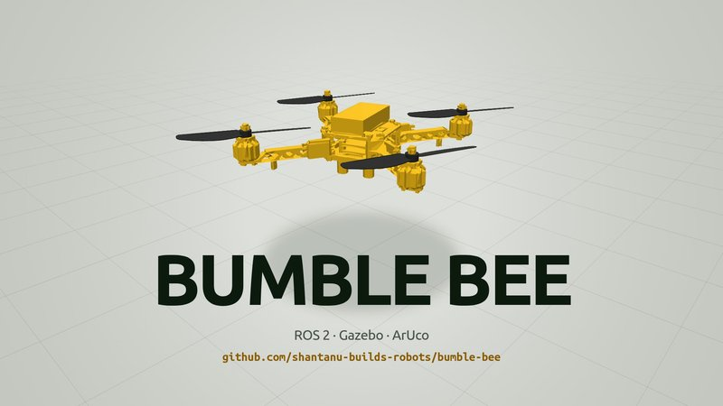
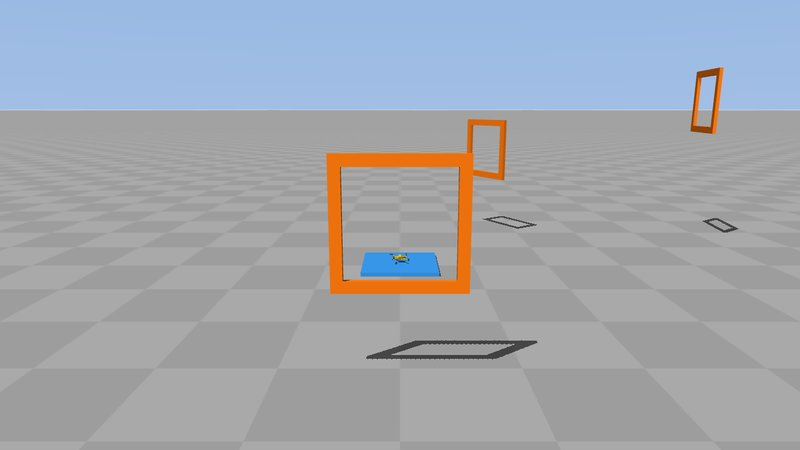
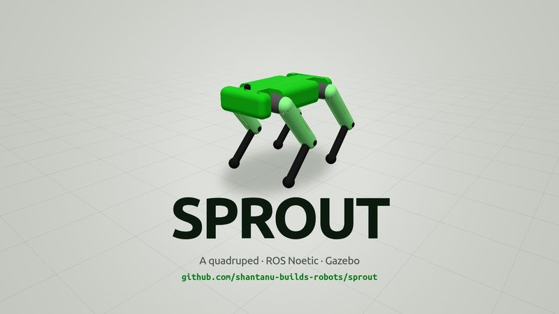
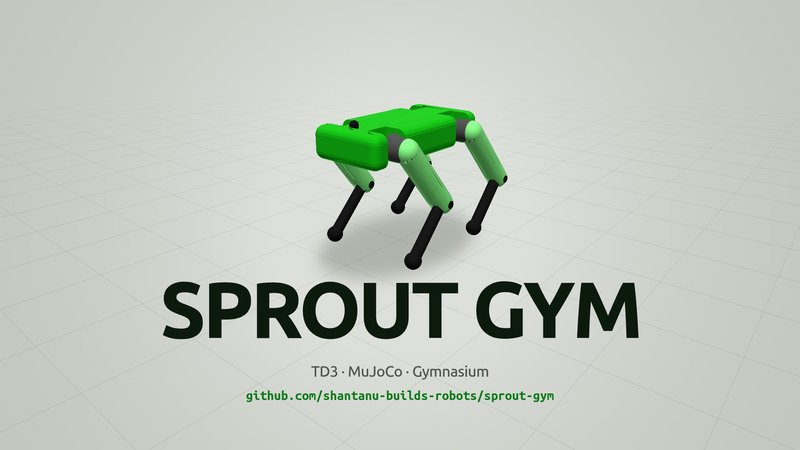
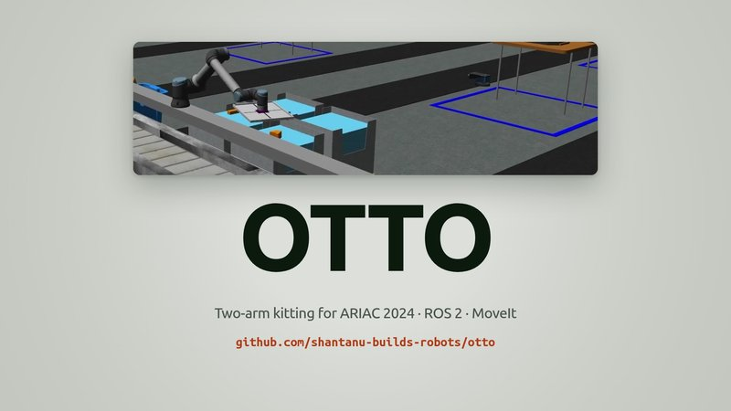
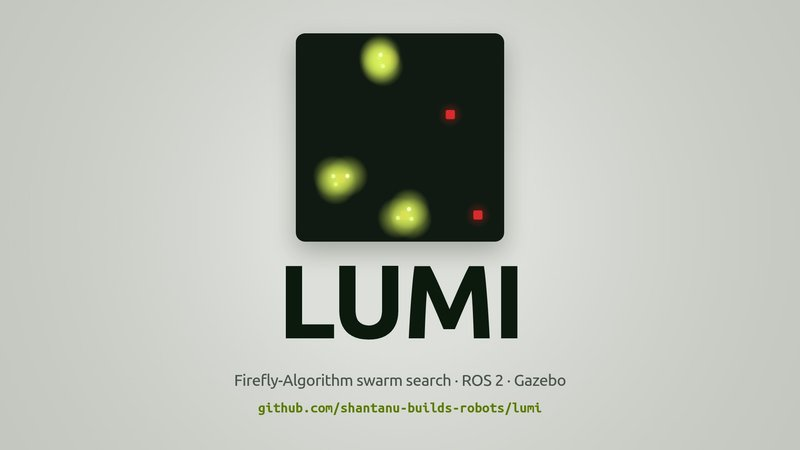
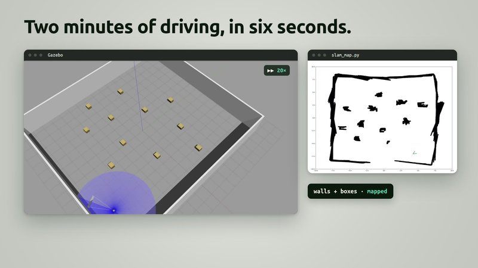
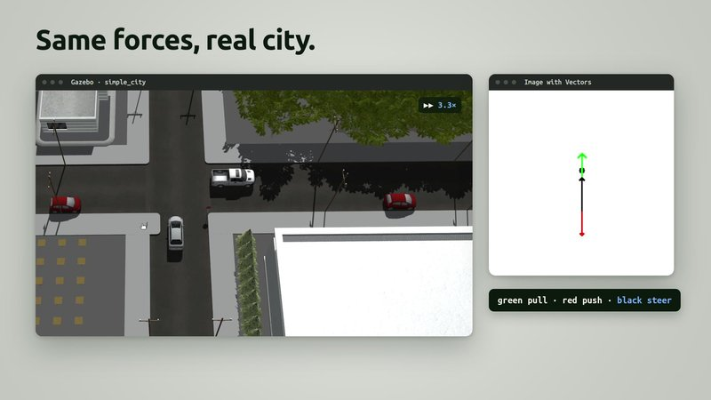
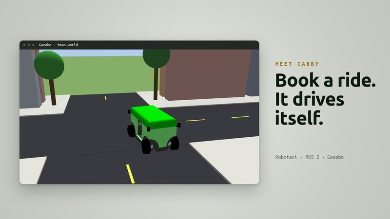
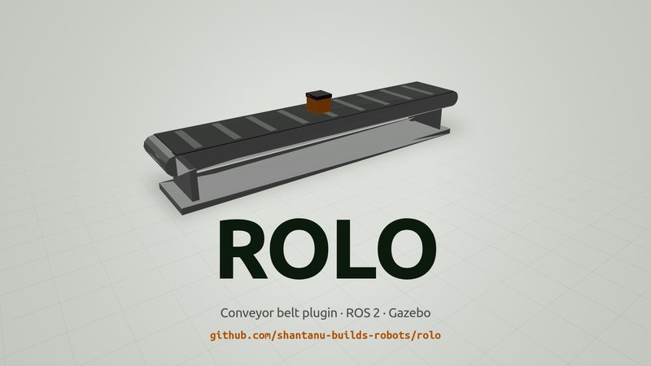

# Shantanu builds robots 🤖

I build robots in simulation (drones, quadrupeds, arms, swarms and self-driving cars) with ROS 2, Gazebo and MuJoCo,
and I like writing the plugins and controllers that make them move.

## Projects

<table>
<tr>
<td width="50%" valign="top">
 
<b>Bumble Bee</b>: a delivery quadrotor flown by a custom Gazebo plugin. It reads ArUco labels, grabs four parcels and lands back on its pad. 
ROS 2 · Gazebo · C++ plugin · PID
</td>
<td width="50%" valign="top">
 
<b>Bumble Bee Gym</b> <i>(in progress)</i>: a MuJoCo twin of Bumble Bee that flies within 5 mm of Gazebo, plus obstacle and race courses for reinforcement learning. 
MuJoCo · Gazebo · Python
</td>
</tr>
<tr>
<td valign="top">
 
<a href="https://github.com/shantanu-builds-robots/sprout"><b>Sprout</b></a>: a quadruped robot, modelled and walked in Gazebo. 
ROS · Gazebo · URDF
</td>
<td valign="top">
 
<b>Sprout Gym</b>: Sprout learns to walk with reinforcement learning. 
TD3 · MuJoCo · Gymnasium
</td>
</tr>
<tr>
<td valign="top">
 
<b>Otto</b>: a two-arm kitting system for ARIAC 2024, handling priority orders, faulty parts and gripper failures. 
ROS 2 · MoveIt · Gazebo
</td>
<td valign="top">
 
<b>Lumi</b>: a TurtleBot swarm that finds red objects with the Firefly Algorithm. 
ROS 2 · Gazebo · swarm search
</td>
</tr>
<tr>
<td valign="top">
 
<b>Shelly</b>: a TurtleBot3 that maps a room from wheel odometry and a 360° LiDAR. 
ROS 2 · Gazebo · mapping
</td>
<td valign="top">
 
<b>Dash</b>: a self-driving car with A* routing, Virtual Force Field obstacle avoidance and lane detection. 
ROS 2 · Gazebo · planning
</td>
</tr>
<tr>
<td valign="top">
 
<b>Cabby</b>: a four-wheel-steer robotaxi and a ROS 2 starter template with tests and CI. 
ROS 2 · Gazebo · gtest · pytest
</td>
<td valign="top">
 
<b>Rolo</b>: a drop-in Gazebo conveyor belt, switched on and off from a ROS 2 topic. 
ROS 2 · Gazebo · model plugin
</td>
</tr>
</table>

## 🌐 Socials

  

---

